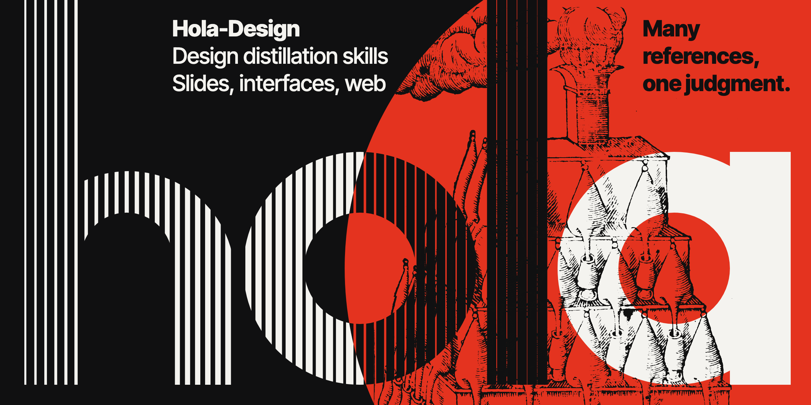
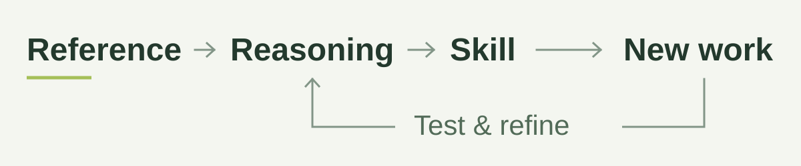

<h1 align="center"></h1>

<p align="center">
  <strong>Turn design references into reusable judgment.</strong><br />
  Evidence-led skills for presentations, product interfaces, and websites.
</p>

<p align="center">
  <strong>English</strong> · <a href="README.zh-CN.md">简体中文</a><br />
  <a href="#quick-start">Quick start</a> ·
  <a href="#choose-a-skill">Skills</a> ·
  <a href="#the-three-loops">Review model</a> ·
  <a href="#tools-and-requirements">Tools</a>
</p>

---

Hola-Design helps an agent learn **why a design works**, preserve the evidence behind that judgment, and apply it to a different brief. It goes beyond collecting colors, font sizes, or component recipes: the reusable knowledge is the relationship between **intention, expression, interaction, and context**.

Presentation, UI, and web design stay separate. They share a reasoning and review method, while keeping their own structures, patterns, and acceptance criteria.

<picture>
  <source media="(prefers-color-scheme: dark)" srcset="assets/readme/workflow-dark.svg" />
  <source media="(prefers-color-scheme: light)" srcset="assets/readme/workflow-light.svg" />
  
</picture>

## Quick start

**1. Get the skills.**

```sh
git clone https://github.com/Ray-hola/Hola-Design.git
cd Hola-Design
```

Open the repository in your coding agent and ask it to read `skills/design-distill/SKILL.md`. For persistent discovery, install the four folders inside `skills/` into your agent's skill directory, keeping them beside one another. Each scene skill also works independently; the router needs its sibling skills.

**2. Supply a reference and a new task.**

```text
Read skills/design-distill/SKILL.md and use the appropriate scene skill.

Learn from the reference I provide. Separate its product intent, structure,
visual relationships, interaction logic, and meaningful exceptions.
Distinguish observations, source declarations, inferences, and unknowns.

Then apply the learned reasoning to my new brief. Render the result,
inspect whole / detail / relationships, challenge its weakest part,
and report the scope actually verified.
```

**3. Look for a traceable result.**

A useful distillation explains what the reference helps someone do, which relationships support that intention, where the proposed rules apply, and what remains unknown. A generated package is testable; its existence alone does not establish design quality or transfer success.

## Choose a skill

| Skill | Use it for |
| --- | --- |
| [`design-distill`](skills/design-distill/SKILL.md) | Routing a mixed or still-unclear brief by its intended use. |
| [`ppt-design-distill`](skills/ppt-design-distill/SKILL.md) | Slide narrative, page roles, content capacity, and native presentation delivery. |
| [`ui-design-distill`](skills/ui-design-distill/SKILL.md) | Product objects, tasks, components, state changes, feedback, and recovery. |
| [`web-design-distill`](skills/web-design-distill/SKILL.md) | Page purpose, section logic, typography, reading and action paths, and responsive composition. |

Route by the future task, not the file extension: a browser-based editor is product UI; a public product landing page is web design.

## What the skills learn

- **Intent before style.** Identify the subject, audience, function, purpose, and conditions of use.
- **Relationships before recipes.** Explain how attention, information, actions, time, and space work together—and what their arrangement costs.
- **Typography as composition.** Study glyph character, word shapes, line breaks, size relationships, direction, spacing, and actual font coverage.
- **Exceptions worth keeping.** A meaningful one-off departure can teach something a repeated token cannot. Compare it against the design's intention rather than normalizing it automatically.
- **Conditional transfer.** Preserve mechanisms and their limits. A pattern that works in a portfolio may obstruct a frequently used workbench.

The [reasoning guide](skills/ui-design-distill/references/method/design-reasoning.md), [distillation method](skills/ui-design-distill/references/method/distill-method.md), and [typography and creative studies](skills/ui-design-distill/references/method/type-and-creative.md) are included in each scene skill.

## The three loops

| Loop | Question | Required evidence |
| --- | --- | --- |
| **Distillation** | Does the explanation remain faithful to the reference? | Traceable instances; declarations and inferences kept separate. |
| **Design** | Does the new output serve the actual brief? | Rendered output, meaningful states, whole/detail/relationship inspection. |
| **Feedback** | What failed when the reasoning met a new task? | A concrete result and a diagnosis: method, learned rule, implementation, or missing coverage. |

Exit requires positive reasons to retain the result, inspection of its weakest subject, a tested objection, and evidence bound to the final revision. A local `PASS` is scoped and revocable. Structural validation is not an aesthetic verdict or independent usability evidence.

Exit also needs an integrity check: content, background, lines, overlaps and the export must all hold on the final version, at every display size. Crossing text, overlap, and cropping can pass when their intent and observed effect are recorded; a label of "intentional" cannot.

See the [LOOP protocol](skills/ui-design-distill/references/loop/loop-protocol.md), [review coverage contract](skills/ui-design-distill/references/loop/review-closure.md), and [exit criteria](skills/ui-design-distill/references/loop/loop-exit.md).

Each scene starts with a compact task contract and an
[execution map](skills/ui-design-distill/references/loop/execution.md): distill
references, apply a learned skill, repair a result, or maintain the skill itself.
The map specifies evidence, transitions and unfinished states; scene references
load when needed. Creative choices remain open within the brief.

The [presentation corpus status](skills/ppt-design-distill/references/lessons/presentation-corpus-status.json)
marks historical learning that skipped LOOP as **UNVERIFIED**. Recomputed source
statistics and preserved materials do not establish design or transfer acceptance.

## Tools and requirements

Core helpers use **Python 3.9+ and the standard library**. The legacy web extraction pipeline additionally requires **Node.js 18+** and the browser adapters described in the [web workflow](skills/web-design-distill/references/scene/web-workflow.md).

From the repository root:

```sh
# Create a fresh task kit; existing destinations are preserved.
python3 skills/ui-design-distill/scripts/kit.py init --out ./design-task

# Retrieve conditional recipes and proposed catalog guidance.
python3 skills/ui-design-distill/scripts/kit.py search "task recovery"
python3 skills/ui-design-distill/scripts/kit.py catalog "error summary" --domain ux

# Look up a design principle question by keyword.
python3 skills/ui-design-distill/scripts/principles.py search "alignment"
```

Each branch has its own recipes. UI and web branches also bundle the [UI UX Pro Max](https://github.com/nextlevelbuilder/ui-ux-pro-max-skill) catalog for font, icon, color and framework lookups. Recipes and catalog results remain proposals: compare them with the reference evidence, current platform, and brief.

<details>
<summary>Profile packaging, font specimens, and review helpers</summary>

Each scene includes:

| Tool | Purpose |
| --- | --- |
| `profile_tools.py` | Validate a scene-specific profile and package a portable consumer skill. |
| `kit.py` | Create a task kit, search recipes, or query the UI/web catalog. |
| `principles.py` | Search the design principle questions or create an unanswered worksheet. |
| `collect_font.py` | Record a supplied font; copy it only with an explicit rights declaration and license. |
| `loop_tools.py` | Bind review coverage and exit assessments to actual artifact revisions. |
| `capture_artifact.py` | Render HTML or an image through installed Chrome; refuse missing fonts or broken images, and flag flat edge bands. |

Use each script's `--help` for its arguments. Font specimens default to English; `--sample-text` accepts the actual writing system and copy required by the brief. English skill content does not restrict the language of a designed artifact.

</details>

Run `python3 scripts/check_repository.py` for source, language, local-link and provenance checks, then `python3 -m unittest discover -s tests` for gate, capture and packaging tests. Browser capture tests are skipped when Chrome/Chromium is unavailable.

For a new contribution, follow [CONTRIBUTING.md](CONTRIBUTING.md). The [publication review](docs/PUBLICATION_REVIEW.md) records the current privacy and rights checks and their limits.

## Repository layout

```text
Hola-Design/
├── README.md
├── README.zh-CN.md
├── LICENSE
├── NOTICE
├── CONTRIBUTING.md
├── docs/PUBLICATION_REVIEW.md   # Publication scope and rights review
├── scripts/check_repository.py # Publication checks
├── scripts/sync_shared.py      # Copy shared/ into each scene skill
├── shared/                     # Single source for files all scenes carry
├── tests/                      # Integrity gate and branch sync tests
├── assets/readme/              # Cover source, final image and workflow artwork
└── skills/
    ├── design-distill/         # Scene router
    ├── ppt-design-distill/     # Presentation workflow and resources
    ├── ui-design-distill/      # Product workflow and resources
    └── web-design-distill/     # Website workflow and resources
```

Scene folders are self-contained. Their scripts, reference guides, starter assets, and supported catalogs travel with the skill. Shared resources are intentionally copied into each branch; changes to a common method should be checked across all three.

**Language policy:** skill instructions, reference material, tools, metadata, and starter assets are maintained in English. Only the README has English and Simplified Chinese editions.

## Attribution and licensing

Two third-party sets are bundled as-is because the skills run on them; the rest of the skill content is written in our own words. Ten web extraction scripts come unchanged from Nathan Onn's [agent-skills](https://github.com/nathanonn/agent-skills), under the MIT license in the [web branch](skills/web-design-distill/NOTICE).

The UI and web branches bundle the code and data of [UI UX Pro Max](https://github.com/nextlevelbuilder/ui-ux-pro-max-skill) by Next Level Builder, MIT License, at a pinned commit in `vendor/ui-ux-pro-max/`. It is not covered by this repository's Apache-2.0 license. Each vendor folder keeps its license, file hashes and the one documented local change: [UI provenance](skills/ui-design-distill/vendor/ui-ux-pro-max/UPSTREAM.json) · [Web provenance](skills/web-design-distill/vendor/ui-ux-pro-max/UPSTREAM.json).

Method lessons from [Impeccable](https://github.com/pbakaus/impeccable) (Apache-2.0) are summarized in our own words, with source locators and what we chose not to adopt: [UI](skills/ui-design-distill/references/lessons/impeccable-lessons.md) · [Web](skills/web-design-distill/references/lessons/impeccable-lessons.md) · [Presentations](skills/ppt-design-distill/references/lessons/impeccable-lessons.md).

The cover uses a woodcut from [Wellcome Collection](https://wellcomecollection.org/works/zzxxubww), marked Public Domain Mark: [source record](assets/readme/cover-source/SOURCE.md).

Other method references are recorded in each skill's `NOTICE`. Hola-Design's original material is licensed under the [Apache License 2.0](LICENSE). Third-party materials keep their own terms and are listed in [NOTICE](NOTICE). Apart from that public-domain woodcut, books, third-party artwork, font binaries, browsing sessions, and research captures are not distributed here.


## Maintenance

Change a scene under `skills/`; edit files shared by all scenes in `shared/` and run `python3 scripts/sync_shared.py`. Keep skill content in English and update both READMEs when the public instructions change. Record third-party file changes in their provenance manifest and retain the applicable license. Keep private repositories, task journals and source materials in local `private/`; put disposable working files in `temp/`. Both are excluded from Git. `python3 scripts/clean_temp.py` previews cleanup; `--apply` removes unprotected temporary items unchanged for 14 days. Use `.keep` inside an active task folder to retain it. Private storage is never auto-cleaned. The local daily automation is not installed by cloning this repository. Report reproducible, non-sensitive problems through [Issues](https://github.com/Ray-hola/Hola-Design/issues).
