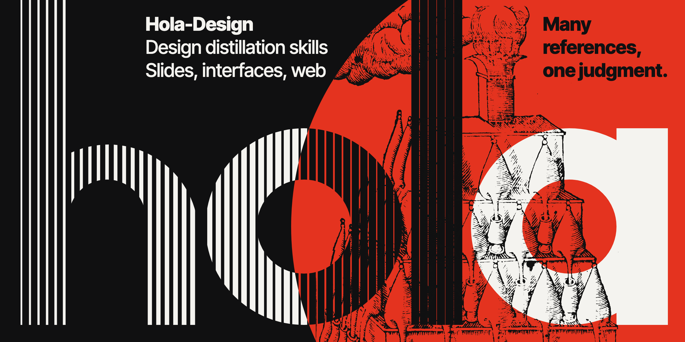
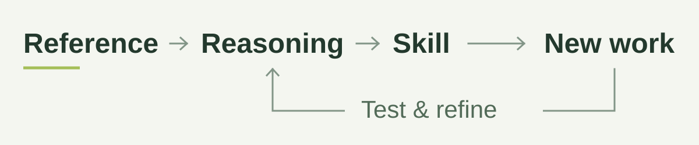

<h1 align="center"></h1>

<p align="center">
  <strong>把设计参考，转化为可复用的判断。</strong><br />
  面向 PPT、产品界面与网页，以证据为基础的设计蒸馏 skills。
</p>

<p align="center">
  <a href="README.md">English</a> · <strong>简体中文</strong><br />
  <a href="#快速开始">快速开始</a> ·
  <a href="#选择-skill">场景入口</a> ·
  <a href="#三层-loop">审阅机制</a> ·
  <a href="#工具与环境">工具</a>
</p>

---

Hola-Design 帮助代理学习**一个设计为什么有效**，保留判断背后的证据，并把它应用到不同的任务中。它不止收集配色、字号和组件配方；真正需要复用的是**意图、表达、交互与使用条件之间的关系**。

PPT、UI 和网页保持独立。它们共享推理与审阅方法，同时保留各自的结构、模式和验收标准。

<picture>
  <source media="(prefers-color-scheme: dark)" srcset="assets/readme/workflow-dark.svg" />
  <source media="(prefers-color-scheme: light)" srcset="assets/readme/workflow-light.svg" />
  
</picture>

## 快速开始

**1. 获取 skills。**

```sh
git clone https://github.com/Ray-hola/Hola-Design.git
cd Hola-Design
```

在编程代理中打开仓库，让它读取 `skills/design-distill/SKILL.md`。需要长期发现和调用时，将 `skills/` 下四个目录安装到代理的 skill 目录中，保持同级。三个场景分支也可以单独使用；路由器需要相邻的场景 skills。

**2. 提供参考和新任务。**

```text
读取 skills/design-distill/SKILL.md，并选择适合的场景分支。

学习我提供的参考，分清产品意图、结构、视觉关系、交互逻辑和有意义的例外。
区分实际观察、来源声明、推断和未知。

然后将学到的推理用于我的新任务。渲染产物，检查整体、细节与关系，
挑战其中最弱的部分，并说明实际验证过的范围。
```

**3. 检查结果能否追溯。**

有效的蒸馏应该说明：参考在帮助谁完成什么，哪些关系支持这一目的，提炼的规则在什么条件下适用，以及哪些内容仍然未知。生成的包可以用于测试，但包的存在不等于设计质量或迁移效果已经得到证明。

## 选择 skill

| Skill | 适用任务 |
| --- | --- |
| [`design-distill`](skills/design-distill/SKILL.md) | 按最终用途，为混合或尚不明确的任务选择场景。 |
| [`ppt-design-distill`](skills/ppt-design-distill/SKILL.md) | 幻灯片叙事、页面角色、内容容量与原生演示文稿交付。 |
| [`ui-design-distill`](skills/ui-design-distill/SKILL.md) | 产品对象、任务、组件、状态变化、反馈与恢复。 |
| [`web-design-distill`](skills/web-design-distill/SKILL.md) | 页面目的、章节逻辑、排印、阅读与行动路径，以及响应式构图。 |

根据未来任务分类，而不是根据扩展名：浏览器里的编辑器属于产品 UI，公开的产品落地页属于网页设计。

## Skills 学习什么

- **先看意图，再看风格。** 明确主题、受众、功能、目的与使用条件。
- **先理解关系，再选择配方。** 解释注意力、信息、操作、时间和空间如何配合，以及这种安排的代价。
- **把字体视为构图。** 检查字形气质、整词轮廓、断行、大小关系、方向、间距与实际字形覆盖。
- **保留有价值的例外。** 有意义的独特设计也能形成知识；应结合其意图比较，而不是自动把它改回惯常形式。
- **带着条件迁移。** 保留机制及其边界。适合浏览作品集的模式，可能妨碍高频使用的工作台。

每个场景都包含[设计推理指南](skills/ui-design-distill/references/method/design-reasoning.md)、[蒸馏方法](skills/ui-design-distill/references/method/distill-method.md)和[字体与创意研究方法](skills/ui-design-distill/references/method/type-and-creative.md)。

## 三层 LOOP

| LOOP | 核心问题 | 所需证据 |
| --- | --- | --- |
| **蒸馏** | 解释是否忠于参考？ | 可追溯的实例；分开的来源声明与推断。 |
| **设计** | 新产物是否服务真实任务？ | 渲染结果、有意义的状态，以及整体、细节和关系审阅。 |
| **反馈** | 推理遇到新任务时，哪里失效了？ | 具体结果，以及对方法、已学规则、实现或检查遗漏的归因。 |

准出需要正面的保留理由、最弱对象的检查、实际检验过的反对意见，以及绑定最终版本的证据。局部 `PASS` 有明确范围，也可以被新证据撤销。结构检查不等于审美判断或独立可用性证据。

准出还要通过完整性检查:内容、背景、线条、叠压与导出文件,都要在最终版本和每个展示尺寸上成立。穿字、叠压和裁切只要记录了意图和实际效果就可以通过;只写一句“这是有意设计”不能通过。

详见 [LOOP 协议](skills/ui-design-distill/references/loop/loop-protocol.md)、[审阅覆盖约定](skills/ui-design-distill/references/loop/review-closure.md)和[准出条件](skills/ui-design-distill/references/loop/loop-exit.md)。

每个场景现在从简短的任务契约和[执行导航](skills/ui-design-distill/references/loop/execution.md)开始，区分蒸馏参考、应用已有 skill、修复产物与维护 skill。导航明确所需证据、推进条件和未完成状态，场景资料按需读取；创意选择仍由任务意图与实际效果决定。

[演示文稿语料状态](skills/ppt-design-distill/references/lessons/presentation-corpus-status.json)明确将历史上跳过 LOOP 的学习标为 **UNVERIFIED**。材料保全与统计复算，不等于设计质量或迁移验证通过。

## 工具与环境

核心工具使用 **Python 3.9+ 及标准库**。旧版网页提取链还需要 **Node.js 18+**，以及[网页工作流](skills/web-design-distill/references/scene/web-workflow.md)中说明的浏览器适配环境。

在仓库根目录执行：

```sh
# 创建新的任务套件；保留已有目标目录。
python3 skills/ui-design-distill/scripts/kit.py init --out ./design-task

# 检索带适用条件的配方和候选目录建议。
python3 skills/ui-design-distill/scripts/kit.py search "task recovery"
python3 skills/ui-design-distill/scripts/kit.py catalog "error summary" --domain ux

# 按关键词检索设计原理问题。
python3 skills/ui-design-distill/scripts/principles.py search "alignment"
```

动画学习时，各场景和生成的产物 skill 还包含固定版本的
[Reanimate](https://github.com/NiazMorshed2007/reanimate) 后端（MIT），提供录制、视频采样、缓动分析、逐帧差异与联系表工具，证据接入既有三层 LOOP。
从 `scripts/motion_tools.py doctor` 和[动态复刻指南](skills/ui-design-distill/references/toolkit/motion-reconstruction.md)开始。
可用 `motion_tools.py setup --allow-browser` 在用户缓存中引导安装固定版本 Bun、依赖和 Chromium；仅使用 Python 的任务维持原有环境要求。
比较会检查完整帧覆盖和明确的精度阈值，测量合格不会自动产生设计 PASS。

各分支有自己的配方。UI 与 Web 分支另外内置 [UI UX Pro Max](https://github.com/nextlevelbuilder/ui-ux-pro-max-skill) 目录，可检索字体、图标、配色和各框架指南。配方和目录结果仍是候选建议，需要结合参考证据、当前平台和任务判断。

<details>
<summary>Profile 打包、字体样张与审阅工具</summary>

每个场景包含：

| 工具 | 用途 |
| --- | --- |
| `profile_tools.py` | 验证场景 profile，打包可独立使用的产物 skill。 |
| `kit.py` | 创建任务套件，检索配方，或查询 UI/Web 目录。 |
| `principles.py` | 检索设计原理问题，或创建未填写结论的工作表。 |
| `collect_font.py` | 记录所提供的字体；只有明确声明分发权并提供许可时才复制字体文件。 |
| `loop_tools.py` | 将审阅覆盖与准出判断绑定到真实产物版本。 |
| `capture_artifact.py` | 用已安装的 Chrome 渲染 HTML 或图片;字体缺失或图片损坏时拒绝截图,并标记边缘的纯色带。 |

使用各脚本的 `--help` 查看参数。字体样张默认英文；`--sample-text` 可以传入任务所需语言和实际文案。Skill 内部使用英文，不限制设计产物的语言。

</details>

先运行 `python3 scripts/check_repository.py` 检查源码、语言、本地链接与来源哈希，再运行 `python3 -m unittest discover -s tests` 检查闸门、截图与打包。未安装 Chrome/Chromium 时，浏览器截图测试会跳过。

## 仓库结构

```text
Hola-Design/
├── README.md
├── README.zh-CN.md
├── LICENSE
├── NOTICE
├── CONTRIBUTING.md
├── docs/PUBLICATION_REVIEW.md   # 发布范围与权利审查
├── scripts/check_repository.py # 发布前检查
├── scripts/sync_shared.py      # 将 shared/ 同步到各场景 skill
├── shared/                     # 各场景共用文件的唯一来源
├── tests/                      # 完整性闸门与分支同步测试
├── assets/readme/              # 封面源稿、最终图片与工作流图
└── skills/
    ├── design-distill/         # 场景路由
    ├── ppt-design-distill/     # 演示文稿工作流与资源
    ├── ui-design-distill/      # 产品界面工作流与资源
    └── web-design-distill/     # 网页工作流与资源
```

场景目录可以独立使用。脚本、参考文档、初始模板和受支持的检索目录随 skill 一起分发。公共资源有意保留在各分支内部；修改共同方法时，应同步检查三个分支。

**语言约定：** Skill 指令、参考材料、工具、元数据和初始模板均使用英文。仅 README 提供英文与简体中文两版。

## 来源与许可

有三组第三方内容因 skill 运行需要而内置，skill 的其余内容都用我们自己的语言编写。十个网页提取脚本原样来自 Nathan Onn 的 [agent-skills](https://github.com/nathanonn/agent-skills)，MIT 许可保留在 [Web 分支](skills/web-design-distill/NOTICE)。

UI 与 Web 分支内置 Next Level Builder 的 [UI UX Pro Max](https://github.com/nextlevelbuilder/ui-ux-pro-max-skill) 代码和数据，采用 MIT 许可，固定版本存放在 `vendor/ui-ux-pro-max/`，不受本仓库 Apache-2.0 许可覆盖。各 vendor 目录保留许可证、文件哈希和唯一一处本地修改的记录：[UI 来源记录](skills/ui-design-distill/vendor/ui-ux-pro-max/UPSTREAM.json) · [Web 来源记录](skills/web-design-distill/vendor/ui-ux-pro-max/UPSTREAM.json)。

三个场景分支及生成的消费 skill 都内置 Niaz Morshed 的
[Reanimate](https://github.com/NiazMorshed2007/reanimate) 固定版本原始 skill 源码，
采用 MIT 许可，保留许可证和逐文件哈希：[动态工具来源记录](skills/ui-design-distill/vendor/reanimate/UPSTREAM.json)。
该许可不延伸到采集到的第三方图片、字体或网站代码。

来自 [Impeccable](https://github.com/pbakaus/impeccable)(Apache-2.0)的方法经验已用我们自己的语言总结,附来源位置以及我们选择不采用的部分:[UI](skills/ui-design-distill/references/lessons/impeccable-lessons.md) · [Web](skills/web-design-distill/references/lessons/impeccable-lessons.md) · [PPT](skills/ppt-design-distill/references/lessons/impeccable-lessons.md)。

封面使用了[惠康收藏馆](https://wellcomecollection.org/works/zzxxubww)的一幅木刻,馆方标注为公有领域标记:[来源记录](assets/readme/cover-source/SOURCE.md)。

其他方法参考记录在各 skill 的 `NOTICE` 中。Hola-Design 的原创内容采用 [Apache License 2.0](LICENSE) 许可。第三方材料保留各自许可，并列在 [NOTICE](NOTICE) 中。除上述公有领域木刻外,仓库不分发书籍、第三方作品图片、字体二进制、浏览登录数据或研究抓取文件。

## 维护

修改入口位于 `skills/`；各场景共用的文件在 `shared/` 中修改，再运行 `python3 scripts/sync_shared.py` 同步。Skill 内部保持英文，公开使用说明变动时同步两份 README。第三方文件有改动时更新来源清单并保留适用许可证。任务日志、浏览截图、参考书和私人源文件保留在本地 `private/`，不进入发布内容。贡献步骤见 [CONTRIBUTING.md](CONTRIBUTING.md)，本次脱敏与权利审查范围见 [发布审查记录](docs/PUBLICATION_REVIEW.md)。可复现且不含敏感信息的问题可提交到 [Issues](https://github.com/Ray-hola/Hola-Design/issues)。

本地使用 `private/` 保存私人仓库、来源材料、审阅日志和恢复备份，使用 `temp/` 保存可丢弃的临时文件；两个目录均排除在 Git 之外。`python3 scripts/clean_temp.py` 只预览，添加 `--apply` 才清理连续 14 天未更新且未受保护的临时项。正在使用或需要保留的任务目录内放置 `.keep`；私人资料不会被自动清理。本机的每日清理任务不会随仓库克隆自动安装。
